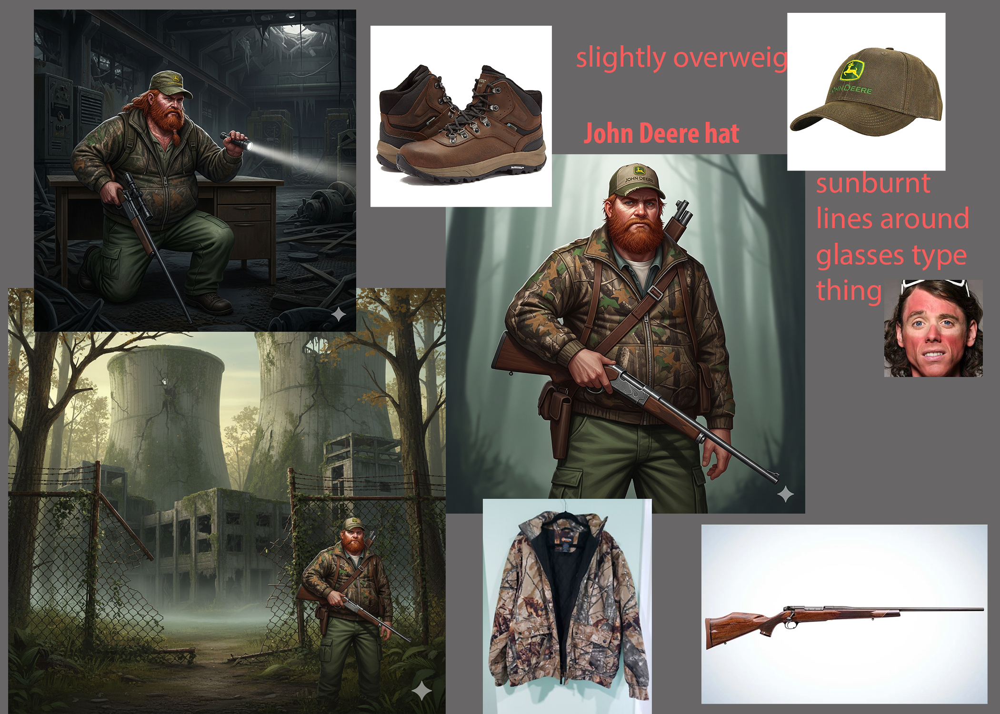
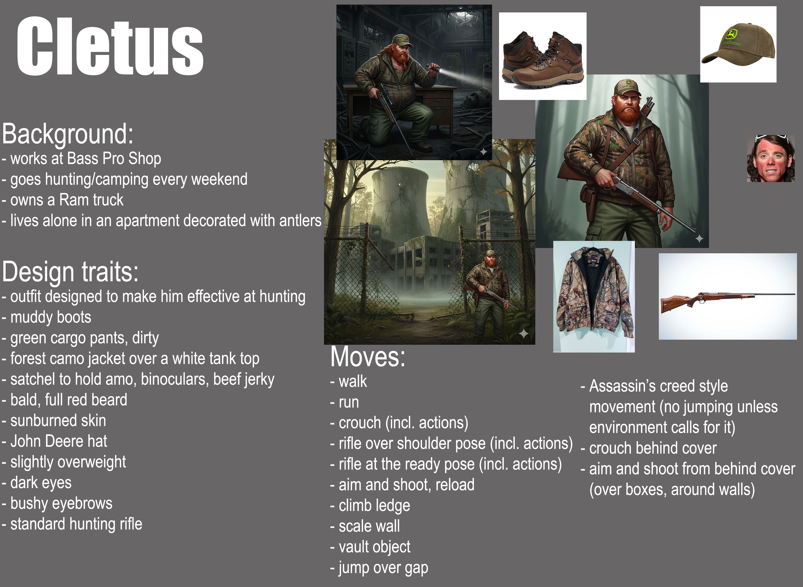

# Cletus - Unreal Gameplay Systems

Cletus is a third-person Unreal Engine project centered on an original
MetaHuman character and a set of gameplay systems implemented for CSANM 342.
The character, gameplay logic, and systems are my work. Some clothing was
tailored with MetaTailor.

## Systems

- Aim-down-sights weapon interaction
- Weapon wheel and weapon selection
- Parkour traversal and obstacle interaction
- Third-person character movement and camera behavior
- MetaHuman character integration

## Technical focus

This project demonstrates gameplay-system design in Unreal Engine, including
input-driven state changes, camera transitions, weapon selection, and traversal
logic. The implementation is primarily Blueprint-based.

## Media

Gameplay footage and the visual breakdown are available on
[ArtStation](https://peterhill.artstation.com/).

## Project information

- Engine association: Unreal Engine 5.7
- Project descriptor: [`project/Cletus_v002.uproject`](./project/Cletus_v002.uproject)
- Configuration files: [`project/Config/`](./project/Config/)

## Repository scope

This is a public showcase repository, not a complete distributable copy of the
Unreal project. The original project contains approximately 2.7 GB of Content,
including MetaHuman and other large asset payloads. Those files are intentionally
not copied here because of repository size and asset-redistribution concerns.
The project descriptor and configuration are included as project metadata while
the technical systems are documented here.

## Asset and licensing note

Before sharing source assets publicly, verify the redistribution terms for
MetaHuman content, clothing, animations, plugins, and any other third-party
assets. Do not treat this repository as a license to redistribute those assets.
